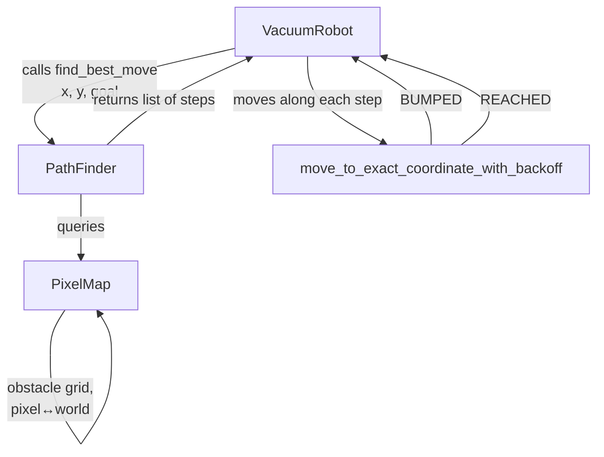

# Take-home assignment: Robot Vacuum Control Software
### Pre-requisites
Install opencv using
```
python3 -m pip install opencv-python numpy
```

### How to run
1. cd into the `examples` directory
2. run `source .venv/bin/activate` to activate the virtual environment
3. run the program using: `python3 client1.py` use `--scene=04` to specify the scene, default is 1

### Architecture

The `VaccumRobot` class provides an abstraction for low level details in making network calls and interfacing with hardware. `PathFinder` focuses on determining the best possible route using BFS. `PixelMap` processes the image (which contains the initial map of obstacles). The `_bfs` method is called in `PixelMap` because it contains the obstacle map `self.obstacle`. This is not the best possible design and if I had more time I would shift `self.obstacle` to `PathFinder` along with other path-finding methods. `PixelMap` should ideally have a single responsibility of image processing

### Determining the best possible algorithm
As mentioned Breath-First search BFS is chosen to be used for path finding. This is because the image given has pixels which indicate (based on colour) which tiles are marked as obstacles. Adjacent tiles (or pixels) function as nodes that can be traversed.

The main issue with this approach is that it is computationally expensive (depending on the resolution of the image) and can create many small steps that are uneeded eg. moving from (1, 2) to (1, 2.1) to (1, 2.2) can be compressed to (1, 2) to (1, 2.2). In order to address this I added `_compress_path` to `PixelMap` to compress the path and remove uneeded steps.

### Trade offs and known limitations
The robot may encounter foreign objects not shown in the map. The method `add_obstacle_world_coordinates` of `PixelMap` is meant to add a foreign object as an obstacle to the current map, so that the robot knows to avoid that area in future. BFS is then recomputed and a new way around the foreign object is found.

The `radius` parameter of `add_obstacle_world_coordinates` indicates the perimeter surrounding the foreign object that is to be marked as blocked. For example if we have a foreign object found when the robot is at (1, 1), if the `radius` is set to 0.1 all areas from (0.9, 0.9) to (1.1, 1.1) would be marked as an `obstacle`.

I set the clearance to 0.15m. Higher clearance ensures a smoother journey for the robot as the robot is less likely to go near to the foreign object. However, too much clearance (ie. 0.3m) could result in certain pathways being marked as `obstacle` falsely (they are marked as `obstacle` due to the clearance)

The value of 0.15m was determined by trial and error.

### Limitations and extensions
As mentioned earlier I did this code in quite a hurry so if I had more time I would have probably refactored it, shifted all obstacle and path-finding related methods to `PathFinder`.

I would improve on the algorithm if given time. I would create an additional graph, to cache known pathways. If the robot can move from point A to B reliably I would create an edge between those points. Edges can be updated when a better pathway is found

Instead of querying BFS constantly, the robot would do a graph lookup for known routes, if the lookup fails it can fall back on BFS.

In addition, I would probably allow multiple goal selection. This would be a great extension because in real-life, the robot vaccum probably has multiple stops anyways. Getting an algorithm for this would probably be a lot more complicated and hence would require more time.

I would probably make the camera less complicated, most of the code was AI generated possibly due to time constraint.
